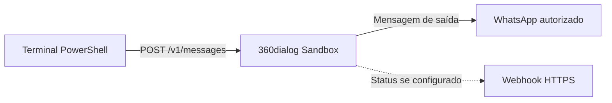
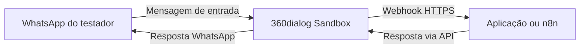

# WhatsApp Sandbox — 360dialog

> Laboratório de integração com WhatsApp API, envio de mensagens em PowerShell e testes de atendimento automatizado.

  

**Projeto:** André Tech — Suporte e Soluções em TI  
**Versão:** 1.0 | **Revisão:** 26/11/2026  
**Natureza:** projeto independente de laboratório, sem vínculo oficial com a 360dialog ou a Meta.

## Sumário

- [1. Objetivo](#1-objetivo)
- [2. Arquitetura e direção das mensagens](#2-arquitetura-e-direção-das-mensagens)
- [3. Requisitos](#3-requisitos)
- [4. Ativação do Sandbox](#4-ativação-do-sandbox)
- [5. Executar o simulador](#5-executar-o-simulador)
- [6. API de mensagens](#6-api-de-mensagens)
- [7. Configurar o webhook](#7-configurar-o-webhook)
- [8. Testes de chatbot](#8-testes-de-chatbot)
- [9. Modelos de mensagens](#9-modelos-de-mensagens)
- [10. Limitações e produção](#10-limitações-e-produção)
- [11. Troubleshooting](#11-troubleshooting)
- [12. Segurança](#12-segurança)
- [13. Publicação no GitHub](#13-publicação-no-github)
- [14. Referências](#14-referências)

## 1. Objetivo

O Sandbox da 360dialog oferece um ambiente gratuito para experimentar a API do WhatsApp sem contratar uma integração de produção. O projeto demonstra autenticação, requisições REST, mensagens de texto, webhooks e validação de fluxos de atendimento.

O simulador permite digitar mensagens em um terminal PowerShell e recebê-las no próprio WhatsApp cadastrado. É útil para encenar falas de clientes, testar visualização e documentar conversas de homologação, sem comprar um segundo chip para esse cenário.

**Atenção:** o número do Sandbox é compartilhado, não é um número comercial exclusivo nem uma conta comum à qual você pode fazer login. O script envia mensagens **do Sandbox para o WhatsApp autorizado**; ele não injeta automaticamente mensagens de entrada no seu chatbot. Para validar o processamento real de uma entrada, utilize o webhook e envie a mensagem pelo WhatsApp do testador ao Sandbox.

## 2. Arquitetura e direção das mensagens

### Envio pelo simulador



### Teste de atendimento automatizado



Neste segundo fluxo, a aplicação é responsável por interpretar a mensagem, manter o estado da conversa e gerar a resposta. O Sandbox não cria a lógica de atendimento. Para Chatwoot, n8n ou WAHA, verifique se a integração escolhida suporta esse endpoint, a autenticação e os eventos da 360dialog; não presuma que sejam intercambiáveis.

## 3. Requisitos

- Windows com Windows PowerShell 5.1 ou PowerShell 7+.
- Acesso à internet e ao WhatsApp.
- Chave de teste vinculada ao destinatário.
- Git (opcional, para versionamento).
- URL HTTPS acessível externamente (para webhooks).

O envio simples não exige Docker, emulador Android, servidor local ou biblioteca adicional.

Verifique a versão do PowerShell e a conectividade:

```powershell
$PSVersionTable.PSVersion
Test-NetConnection waba-sandbox.360dialog.io -Port 443
```

## 4. Ativação do Sandbox

1. Abra o WhatsApp no celular que será usado como destinatário.
2. Inicie a conversa com o número oficial de teste: **+55 11 4673-3492**.
3. Envie `START` em letras maiúsculas.
4. Se solicitado, escolha se deseja compartilhar seu número com a conta comercial.
5. Aguarde a resposta com a API Key e guarde-a em local seguro.

**Link oficial de ativação:** [Abrir conversa com o Sandbox](https://wa.me/551146733492?text=START).

Se o telefone não for compartilhado, a chave pode chegar acompanhada de um **BSUID** (identificador do usuário no contexto daquela empresa). Nesse caso, use esse identificador no lugar do telefone. A chave só autoriza o destinatário ao qual foi vinculada; não tente usar um número diferente.

## 5. Executar o simulador

### Estrutura do repositório

```text
360dialog-whatsapp-sandbox/
├── README.md
├── simulador-cliente.ps1
├── configurar-webhook.ps1
└── .gitignore
```

Abra o PowerShell na pasta do projeto e execute:

```powershell
.\simulador-cliente.ps1
```

Informe a API Key (entrada oculta), escolha telefone ou BSUID e digite o identificador correspondente. Para números brasileiros, informe DDI 55, DDD e número, sem símbolos ou espaços. A chave fica apenas em memória durante a execução do script.

Se a política de execução bloquear um arquivo que você já revisou e confia:

```powershell
Set-ExecutionPolicy -Scope Process -ExecutionPolicy RemoteSigned
.\simulador-cliente.ps1
```

Se o arquivo estiver marcado como baixado da internet, revise seu conteúdo e, somente se confiável, execute `Unblock-File .\simulador-cliente.ps1`. Não altere a política global da máquina; políticas corporativas podem prevalecer.

### Exemplo de sessão (ilustrativo)

```text
========================================
 ANDRE TECH - SIMULADOR DE CLIENTE
========================================
Modo: Telefone
Digite /fim para fechar o simulador

CLIENTE: Olá! Preciso de suporte técnico.
[OK] Requisição aceita pela API.
CLIENTE: Meu notebook está lento. Quanto custa?
[OK] Requisição aceita pela API.
CLIENTE: /fim
```

Cada linha enviada gera uma requisição. Linhas vazias são ignoradas e `/fim` encerra a sessão sem consumir uma requisição. As mensagens digitadas no terminal são entregues como mensagens do Sandbox, não como eventos de cliente recebidos por sua aplicação.

### Como funciona o script

| Componente | Função |
|---|---|
| `Read-Host -AsSecureString` | Oculta a chave durante a digitação. |
| `while ($true)` | Mantém a sessão interativa. |
| `IsNullOrWhiteSpace` | Impede o envio de linhas vazias. |
| `ConvertTo-Json -Depth 5` | Serializa a estrutura da requisição. |
| `UTF8.GetBytes` | Preserva acentos no corpo enviado. |
| `Invoke-RestMethod` | Executa o POST HTTPS e interpreta a resposta. |
| `try/catch` | Trata falhas sem interromper a sessão (exceto limite HTTP 429). |
| `finally` | Descarta a referência à chave ao encerrar. |

O código-fonte está em [simulador-cliente.ps1](simulador-cliente.ps1).

## 6. API de mensagens

| Propriedade | Valor |
|---|---|
| Método | `POST` |
| Endpoint | `https://waba-sandbox.360dialog.io/v1/messages` |
| Autenticação | Cabeçalho `D360-API-KEY` |
| Formato | JSON em UTF-8 |

Exemplo de estrutura para uma conta vinculada a telefone (substitua o marcador em tempo de execução):

```json
{
  "messaging_product": "whatsapp",
  "recipient_type": "individual",
  "to": "SEU_NUMERO_AUTORIZADO",
  "type": "text",
  "text": {
    "body": "Olá! Preciso de suporte técnico."
  }
}
```

Para uma conta identificada por BSUID, use `recipient` em vez de `to` e informe o BSUID recebido. O script oferece ambos os modos.

Uma requisição aceita retorna HTTP 201 e um identificador de mensagem. Isso confirma a aceitação, não a leitura ou a entrega. Para confirmar entrega, consulte o celular ou processe os eventos de status do webhook.

## 7. Configurar o webhook

Webhooks são notificações HTTP que permitem à sua aplicação receber mensagens de entrada e atualizações de envio. O endereço precisa estar disponível publicamente via HTTPS; `localhost` e IPs privados não são alcançáveis diretamente pela 360dialog.

### Teste inicial

1. Abra [webhook.site](https://webhook.site/) e copie a URL HTTPS temporária. Utilize apenas dados fictícios, pois trata-se de um serviço externo.
2. Execute `.\configurar-webhook.ps1` no PowerShell.
3. Informe a chave do Sandbox e a URL HTTPS copiada.
4. Após a confirmação, envie uma mensagem pelo celular ao número oficial do Sandbox.
5. Confira o JSON de entrada na interface do serviço.

O script registra a URL com `POST https://waba-sandbox.360dialog.io/v1/configs/webhook`, passando a chave no cabeçalho e um objeto JSON com a propriedade `url`. Registrar outra URL substitui a configuração anterior. Para integração real, substitua o coletor por um endpoint da sua aplicação, usando HTTPS e certificado válido.

### Estrutura de evento (exemplo simplificado)

```json
{
  "entry": [{
    "changes": [{
      "field": "messages",
      "value": {
        "messages": [{
          "from": "NUMERO_DO_TESTADOR",
          "id": "ID_DA_MENSAGEM",
          "type": "text",
          "text": { "body": "Olá" }
        }]
      }
    }]
  }]
}
```

Em contas BSUID, a origem é identificada por `from_user_id`. Eventos de status podem conter `statuses` em vez de `messages` e utilizar `recipient_id` ou `recipient_user_id`. Não responda a eventos de status como se fossem mensagens de clientes.

### Integração conceitual com n8n

Configure um nó Webhook (POST), ative o workflow e registre a URL de produção desse nó no Sandbox. Filtre eventos que contenham mensagens, extraia o identificador de origem e o texto, aplique a lógica de atendimento e use um nó HTTP Request para responder pelo endpoint de mensagens. Guarde a chave nas credenciais do n8n. Responda ao webhook rapidamente com HTTP 2xx e implemente deduplicação pelo ID da mensagem para evitar respostas duplicadas. Proteja o endpoint e verifique os mecanismos de validação disponíveis para a integração antes de uso público.

Este repositório não inclui um workflow n8n nem um servidor receptor; o roteiro é um guia de integração.

## 8. Testes de chatbot

Para testar a conversa completa, utilize o fluxo com webhook e envie as entradas pelo celular. O simulador PowerShell é adequado para testar a direção de saída ou encenar mensagens de um cliente no aparelho autorizado.

| ID | Entrada / ação | Resultado esperado |
|---|---|---|
| T01 | Olá! Preciso de suporte técnico. | Mensagem recebida ou menu inicial, conforme fluxo escolhido. |
| T02 | `2` | A aplicação seleciona a opção correspondente no estado atual. |
| T03 | Meu notebook está lento. Quanto custa? | Solicitação registrada e direcionada à etapa comercial prevista. |
| T04 | `MENU` | Retorno ao menu, se implementado. |
| T05 | `TECNICO` | Encaminhamento ao atendimento humano, se implementado. |
| T06 | `SAIR` | Encerramento da conversa, se implementado. |
| T07 | Texto com acentos: `Não consigo conexão.` | Texto preservado. |
| T08 | Linha vazia no terminal | Nenhuma chamada à API. |
| T09 | `/fim` no terminal | Simulador encerrado. |

Esses casos são um plano de homologação, não evidência de execução. Para o fluxo comercial, use informações fictícias e verifique se o chatbot encaminha pedidos de orçamento sem iniciar reparo ou diagnóstico não contratado.

### Checklist

- [ ] Chave recebida e destinatário identificado corretamente.
- [ ] Mensagem de saída aceita e visível no celular.
- [ ] Webhook HTTPS configurado.
- [ ] Evento de entrada recebido e processado pela aplicação.
- [ ] Resposta automática recebida no celular.
- [ ] Estados da conversa e comandos validados.
- [ ] Nenhuma chave, número pessoal ou dado de cliente no Git.

## 9. Modelos de mensagens

A documentação oficial lista três modelos de teste: `disclaimer`, `first_welcome_messsage` (grafia do identificador da API) e `interactive_template_sandbox`. Não é possível criar modelos personalizados nesse ambiente. O inventário efetivo deve ser conferido na documentação do fornecedor.

O simulador deste projeto envia somente texto livre. Para testar modelos, utilize os exemplos do fornecedor com `type: template`, o nome exato do modelo e idioma `en`, respeitando o modo de destinatário da conta.

## 10. Limitações e produção

| Sandbox | Integração de produção |
|---|---|
| Gratuito para experimentação | Serviço sujeito à contratação e tarifação |
| Um destinatário por chave | Destinatários elegíveis conforme regras da plataforma |
| Número de teste compartilhado | Número comercial integrado à plataforma |
| Cota reduzida | Limites e políticas de produção |
| Modelos predefinidos | Gestão de modelos conforme regras da Meta |
| Sem upload/download de mídia via media ID | Recursos conforme API de produção |

**Cota:** na consulta à página técnica em 26/11/2026, o limite informado era de 25 solicitações à API de mensagens, incluindo as rejeitadas que alcançam essa API. Ao esgotar a cota, ocorre HTTP 429. Não presuma que exista renovação automática. Referências antigas mencionavam 200; consulte sempre a página técnica atual.

Para produção, obtenha uma conta e um número comerciais integrados à API oficial, credenciais próprias, webhook estável, consentimento apropriado e cumpra as políticas da Meta. A API de produção usa outro endpoint (`https://waba-v2.360dialog.io/messages`, conforme referência do fornecedor). Não basta trocar o endereço do Sandbox: a configuração e as permissões também mudam.

## 11. Troubleshooting

| Sintoma | Verificação / ação |
|---|---|
| HTTP 400 | Verifique JSON, campos obrigatórios e HTTPS no registro de webhook. |
| HTTP 401 | Confira se a chave de teste está correta e se o cabeçalho foi enviado. |
| HTTP 403 | Confira se o telefone ou BSUID coincide com a chave e se o campo correto foi usado. |
| HTTP 429 | Cota esgotada; encerre os testes e consulte o fornecedor. |
| HTTP 502/504 | Falha de upstream ou timeout; confira status/entrega antes de tentar novamente, evitando duplicatas. |
| HTTP 201, sem mensagem no celular | Confira a conversa e eventos de entrega; aceitação não significa entrega. |
| Webhook não recebe eventos | Confira URL, acessibilidade pública, TLS, método POST e registro atual. |
| Chatbot não responde | Confirme que o evento é uma entrada, que o workflow está ativo e que a resposta usa a chave e o destinatário corretos. |

Diagnóstico de rede no Windows:

```powershell
Resolve-DnsName waba-sandbox.360dialog.io
Test-NetConnection waba-sandbox.360dialog.io -Port 443
```

## 12. Segurança

- Nunca publique a API Key, números pessoais, BSUIDs reais, conversas ou logs com dados de identificação.
- Não salve chaves diretamente no código. A entrada segura oculta a digitação, mas a chave precisa ser convertida temporariamente para texto para formar o cabeçalho HTTP; não é proteção absoluta contra inspeção de memória.
- Não exponha dados de clientes em serviços temporários de webhook.
- Se uma chave for exposta, interrompa seu uso e solicite substituição/revogação pelo mecanismo indicado pelo fornecedor; apagar um commit não revoga credenciais.
- O `.gitignore` é preventivo e não remove arquivos já versionados. Revise `git diff --cached` antes de publicar.

## 13. Publicação no GitHub

Sugestão de nome: `360dialog-whatsapp-sandbox`.

Descrição: Laboratório WhatsApp API 360dialog Sandbox com PowerShell, webhooks e testes de chatbot.

Crie um repositório vazio no GitHub (sem README inicial), extraia os arquivos e execute no PowerShell, dentro da pasta do projeto:

```powershell
git init
git add README.md simulador-cliente.ps1 configurar-webhook.ps1 .gitignore
git diff --cached
git commit -m "docs: adiciona laboratorio 360dialog sandbox"
git branch -M main
git remote add origin https://github.com/SEU_USUARIO/360dialog-whatsapp-sandbox.git
git push -u origin main
```

Substitua `SEU_USUARIO` pelo seu usuário do GitHub. Se `origin` já existir, confira `git remote -v` e altere a URL com `git remote set-url origin URL_CORRETA` se necessário.

**Licença:** não definida nesta versão; escolha uma licença adequada antes de publicar se desejar autorizar reutilização por terceiros.

## 14. Referências

- [360dialog — documentação oficial do Sandbox](https://docs.360dialog.com/docs/get-started/sandbox) (consultada em 26/11/2026; referência principal para limites e endpoints).
- [360dialog — artigo sobre testes da API WhatsApp](https://360dialog.com/blog/br/sandbox-api-whatsapp-como-testar/).
- [Microsoft — Invoke-RestMethod](https://learn.microsoft.com/powershell/module/microsoft.powershell.utility/invoke-restmethod).
- [Microsoft — políticas de execução do PowerShell](https://learn.microsoft.com/powershell/module/microsoft.powershell.core/about/about_execution_policies).

---

**Estado da entrega:** documentação e scripts preparados para homologação. Não foram realizadas chamadas reais à API, testes em um ambiente PowerShell nem publicação no GitHub. Valide em seu ambiente antes de utilizar.
